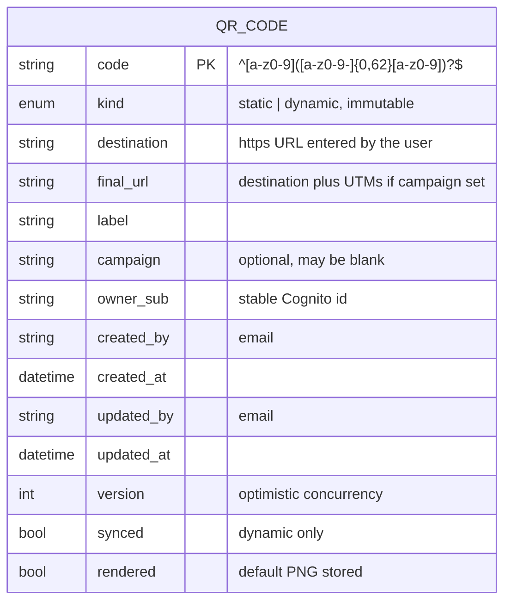
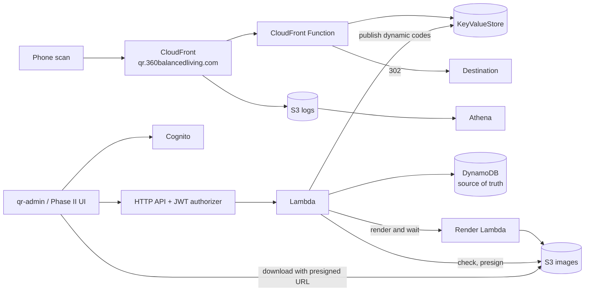
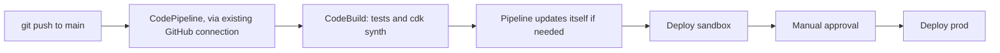
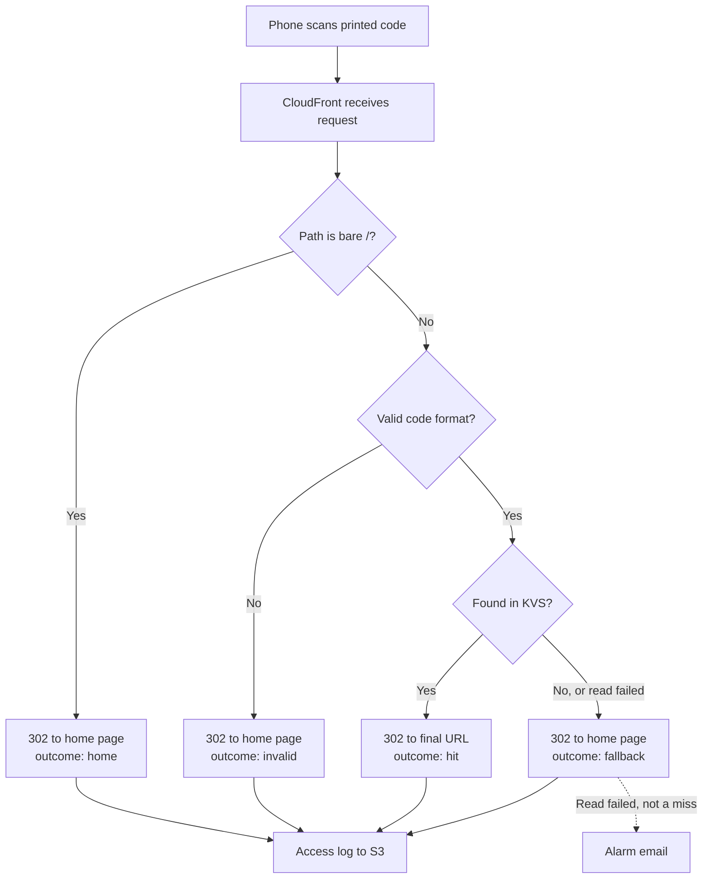
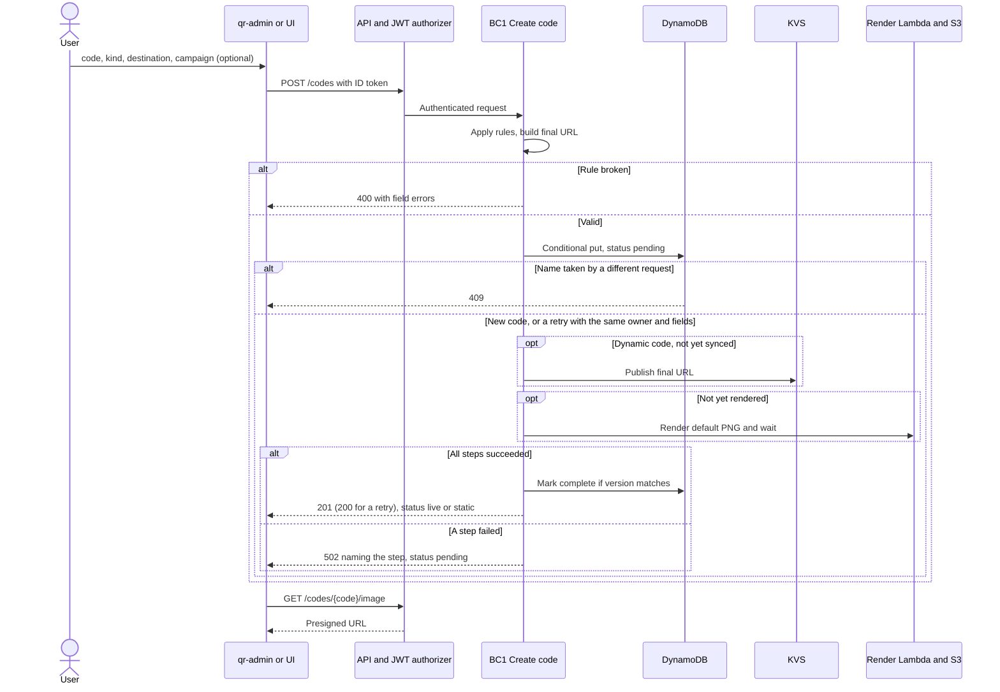
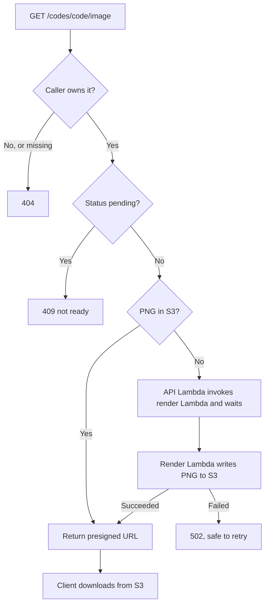
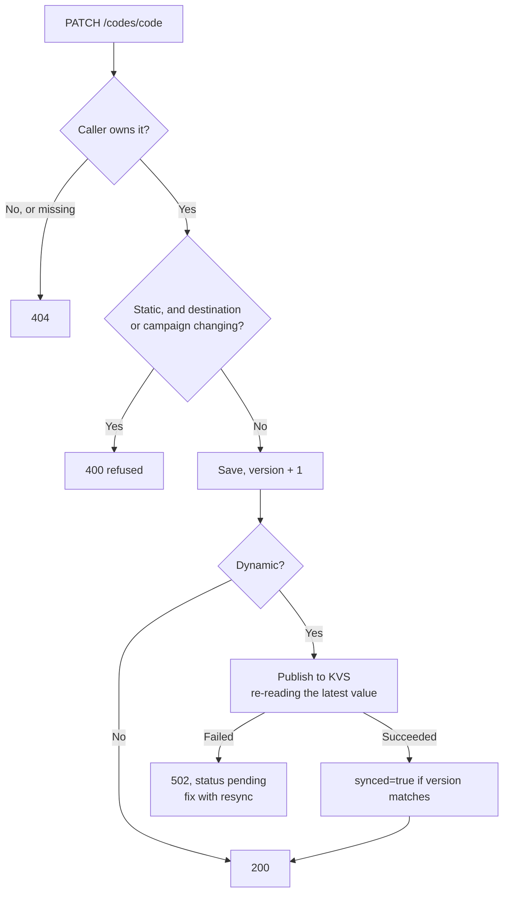
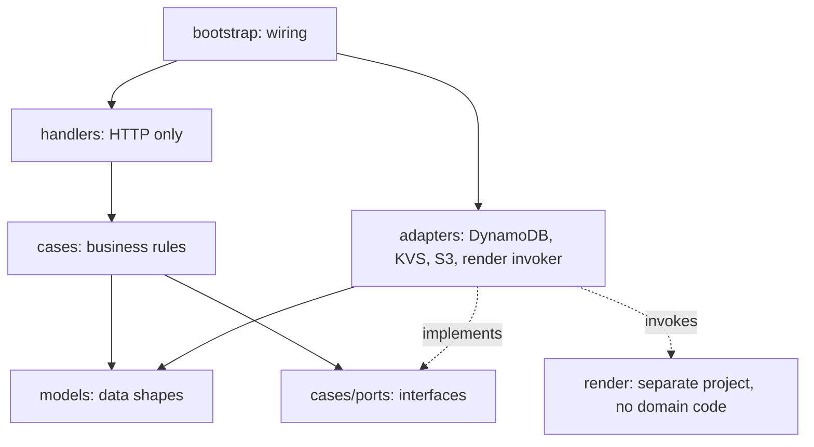

# QR Manager: design document

## 1. Purpose and scope

360 Balanced Living needs to create and manage branded QR codes of two kinds:

- **Static:** the destination URL is encoded in the image and can never change.
- **Dynamic:** the image encodes a short URL on `qr.360balancedliving.com`, and the destination can
  change after printing. Scans are logged for attribution.

| Phase | Delivers | Client |
|---|---|---|
| **Phase I** | Infrastructure and the complete server side | `qr-admin` script |
| **Phase II** | Cognito-authorized web UI for individual users | Browser |

**Guiding rule:** every business decision lives on the server. The script and the UI are both thin
clients of one API. Phase I's script exercises the same contract the UI will use, so Phase II adds a
client, not a rewrite.

## 2. Requirements

### Phase I (no UX)

| ID | Requirement |
|---|---|
| R1 | Create a static code that encodes a fixed destination |
| R2 | Create a dynamic code at `https://qr.360balancedliving.com/<code>` |
| R3 | Change a dynamic code's destination after printing; the printed image keeps working |
| R4 | Scanning a dynamic code issues a 302 to its destination, including UTM parameters |
| R5 | Unknown codes and bare `/` go to the home page, never a 404 |
| R6 | Codes are never deleted or reused |
| R7 | List and view codes |
| R8 | Produce and store the branded PNG for any code, to the existing brand spec |
| R9 | Record every scan of a dynamic code; query them with Athena |
| R10 | Every change is attributed to an authenticated person |
| R11 | Rebuild the live redirect data from the source of truth |
| R12 | Users see and change only their own codes; the code namespace stays global |

Non-functional: scans keep working if the API, Lambda, DynamoDB, or Cognito is down. Cost is
effectively $0 at about 100 scans a week. Infrastructure is CDK. Coding guidelines apply throughout.

### Phase II (UX)

| ID | Requirement |
|---|---|
| U1 | Individual users sign in through Cognito Managed Login |
| U2 | Screens for list, create, edit, and download, for both kinds of code |
| U3 | Users see scan statistics per code |
| U4 | Each user sees only their own codes and statistics |
| U5 | **The UX carries no business logic** (section 8) |
| U6 | Codes left `pending` are repaired automatically, without anyone rerunning a command |

## 3. Business cases

Each case is one module in `cases/`. Rules live here and nowhere else.

| Case | Function | Rules |
|---|---|---|
| **BC1 Create code** | Register a static or dynamic code | Code is unused and not reserved. Destination is `https`. Campaign is optional for both kinds. Caller becomes owner. Dynamic is published to the redirect store. The default PNG is rendered. The code is ready only when every step succeeds. A repeat of the same request succeeds (see below) |
| **BC2 Change code** | Edit a code you own | Dynamic: destination, label, campaign. Static: label and nothing else. Kind never changes. Dynamic changes are republished |
| **BC3 View codes** | List or read your own codes | Returns status and allowed actions |
| **BC4 Get image** | Provide the PNG for a code you own | Static encodes its final URL. Dynamic encodes its short URL. Logo variant `full` or `flower`. `full` is rendered at creation; `flower` on first request, then served from S3. Refused while the code is `pending` |
| **BC5 Resync** | Finish or republish your codes | Completes whichever step is missing. One code, all pending, or all |
| **BC6 Scan stats** (Phase II) | Report scans for your codes | Bots excluded; uniques approximate |
| **BC7 Repair pending** (Phase II) | Scheduled job finishes every `pending` code | System job, so the ownership rule does not apply |

**Shared policies** (`cases/policies.py`): `authorize(actor, code, action)`, reserved codes
(`api`, `admin`, `health`), `https`-only destinations, the 1 KB limit on the final URL, and the
`allowed_actions` calculation.

**Ownership rule, enforced from Phase I:** a user can act only on codes where `owner_sub` matches
their own. Another user's code returns 404, not 403, so the API does not reveal it exists. Code names
stay globally unique because they share one URL space, so creating a taken name still returns 409.

**Idempotent create:** if `POST /codes` finds the code already exists with the same owner and the same
fields, it treats the request as a retry: it finishes any incomplete step and returns success. This
covers a lost response, where the first write succeeded but the caller never heard. Any other
existing code returns 409.

**UTM rule** (`cases/redirect_url.py`): with a campaign, the final URL gains
`utm_source=qr&utm_medium=print&utm_campaign=<campaign>&utm_content=<code>`. With a blank campaign,
the final URL is the destination unchanged. That suits single-use codes: dynamic scans are still
counted per code in the logs, but the destination's own analytics see no UTM attribution.

There is no delete case, and no DELETE route. To retire a dynamic code, point it at the home page.

## 4. Data model

Data modeling is separate from the business cases. `models/` describes what things *are*. It contains
no rules, workflows, permissions, or I/O. Structural validity, such as the code's character format,
belongs here; decisions such as "reserved" or "static cannot change" do not.



| Model | Purpose |
|---|---|
| `QrCode` | The code entity above |
| `CodeKind` | `static` or `dynamic` |
| `CodeStatus` | Derived: `pending` until `rendered` is true and, for dynamic codes, `synced` is true; then `static` or `live` |
| `Actor` | Authenticated caller: `sub`, `email`, `groups` |

**Three shapes are kept distinct.** The domain model is `QrCode`. The storage shape (DynamoDB item)
is mapped in the repository. The API shape (request and response schemas) is mapped in the handlers.
A storage or API change does not touch the model.

**Storage:** table `qr-manager-<env>-codes`, PK `code`, with GSI `by-owner` (`owner_sub`, `created_at`) for
"my codes". On-demand, PITR, deletion protection, RETAIN. **DynamoDB is the source of truth.**
KVS is a read projection of dynamic codes only (key `code`, value `final_url`).

## 5. Architecture

The AWS schematic is in [`aws-architecture.drawio`](aws-architecture.drawio).



- **Scan path has no dependency on the API side.** Static codes never touch our infrastructure.
- **All in us-east-1**, unlike the us-west-2 siblings. The cert, KVS, and log delivery belong there,
  and the SES identity is there, so one region removes cross-region references.
- **`qr.` stays redirect-only**, because any path there is a code. The UI gets
  `qr-admin.360balancedliving.com`, with `/api/*` proxied to the API, which avoids CORS.

| Stack (CDK TypeScript) | Contents | Why separate |
|---|---|---|
| `qr-manager-Edge` | Cert, KVS, function and log group, distribution, Route 53 alias, log bucket, log delivery, KVS failure alarm, SNS alert topic | Printed codes depend on it, so API deploys must not touch it |
| `qr-manager-Auth` | Invite-only pool (RETAIN), SES email, `qr-cli` client (`disableOAuth: true`) | Holds identities |
| `qr-manager-Api` | DynamoDB table (RETAIN), API Lambda, render Lambda, private images bucket, HTTP API, publish or render failure alarm | Changes most often |
| `qr-manager-Analytics` | Glue table, Athena workgroup | Schema comes from a real log file; fixes must not touch Edge |

The names above are logical. Each environment deploys its own copy as `qr-manager-<env>-<Stack>`, for
example `qr-manager-sandbox-Edge`.

### Environments

All four stacks live in one CDK `Stage` class, and each stack and named resource has an explicit name
that includes the environment. `bin/app.ts` creates the stage twice, so both copies share one
definition and differ only by config.

| Setting | `sandbox` | `prod` |
|---|---|---|
| Domain | `qr-sandbox.360balancedliving.com` | `qr.360balancedliving.com` |
| Cognito pool, KVS, table, buckets | Own copy | Own copy |
| Removal policy | Destroy, no deletion protection | RETAIN, deletion protection |
| Alarm emails | Off | On |

Every change deploys to sandbox first, including the risky first checks in section 11. Sandbox has a
real domain so test codes can be scanned with a phone. The CLI selects an environment with
the required `--env` option, so prod is never used by accident. Deploys are by hand:
`npx cdk deploy 'sandbox/*' --profile brian-admin --outputs-file outputs-sandbox.json`. The CLI reads
`infra/outputs-<env>.json`; each environment has its own file because CDK overwrites the file on each
deploy.

Confirmed in sandbox: the API Lambda's role credentials and the bundled `awscrt` work with the KVS
SigV4A API, so the account-wide session token setting was not needed.

Both copies are in the same account, so they share the CloudFront free tier. At this volume the
sandbox should add almost nothing to the cost.

### Later option: deployment pipeline

**Not built.** Add it after Phase I is running. Because the stacks are already in a `Stage` with
explicit names, adding it does not rename or replace anything.



This would use CDK Pipelines, in a `qr-manager-Pipeline` stack deployed by hand once. The build needs uv
installed. The manual approval keeps prod deploys a deliberate decision. GitHub Actions would not
trigger the pipeline; it would only run checks on pull requests.

### 5.1 Flow charts

**Scan a dynamic code.** This path uses no API, Lambda, DynamoDB, or Cognito.



**Create a code.** Validation and ownership happen before anything is stored. The call is synchronous,
and the code is ready only when the redirect is published and the PNG exists. The first failed step
stops the sequence; a retry completes only what is missing.



**Get the image.** Nothing renders in the background. The default PNG already exists by this point,
so this usually just returns a URL. The render Lambda runs here only for the `flower` variant's first
request. A `pending` code is refused, so nobody can print a code that is not ready.



**Change a code.** The printed image never changes; only the stored destination does.



**Static codes** have no flow of their own after creation: the phone goes straight to the
destination, so none of our infrastructure is involved and no scans are recorded.

### Redirect function

Viewer-request function, JS runtime 2.0, using `cf.kvs()` with no ID. It checks the code format
before reading KVS, so `/favicon.ico` and scanner noise skip the lookup. The whole handler is wrapped
so any failure still returns a 302 to the home page, never a 5xx. It sets `cache-control: no-store`.
`cf.logCustomData` records `<code>:<hit|fallback|invalid|home>`. Athena takes the code from
`cs-uri-stem`, because custom data is absent at embedded POPs.

### Publishing to KVS

Synchronous, inside BC1, BC2, and BC5: write DynamoDB with `synced=false` and `version + 1`. Then, on
each attempt, read the store ETag, read the item with `ConsistentRead`, and `PutKey` that value. Set
`synced=true` only if `version` still matches. Re-reading stops a retry overwriting a newer
destination with a stale one. If `version` has changed, the next attempt republishes the newer value
even if it is marked as synced, because a slower writer may have overwritten it in KVS. On failure the
API returns 502 and the code stays `pending`, visibly.

Because DynamoDB is always written first, KVS can be out of date but never holds a code DynamoDB does
not know about. Scans always get a 302, so a printed code never shows an error page.

| What fails | State afterwards | Effect on scans | Recovery |
|---|---|---|---|
| First DynamoDB write | Nothing changed | New code: goes home. Existing code: unchanged | Caller gets an error and retries |
| KVS write, after its own retries | DynamoDB has the new value, status `pending` | New code: goes home. Changed code: still goes to the old destination | 502, then `update` or `resync` |
| Render, new codes only | Redirect is published, no PNG, status `pending` | None yet: with no PNG, nothing can be printed or scanned | 502, then repeat `create` or run `resync` |
| Lambda dies between the steps | Status stays `pending` | Same as the step that did not run | Caller sees a timeout or 5xx, then the same recovery |
| Final status write | All steps done, status stays `pending` | None | `resync` clears it |

**Repairing `pending` codes:** in Phase I, the caller sees the error, and an alarm on publish or render
failures emails the owner so a failure cannot go unnoticed. Phase II adds BC7, a scheduled job, because
a browser user can leave without retrying.

**Updates do not render.** An existing code's PNG never changes, so `PATCH` only touches DynamoDB and
KVS. No confirming read is needed after a write: KVS's success response and the render Lambda's result
are the confirmation. `live` means KVS accepted the value; edge locations catch up shortly afterwards.
A sandbox test took 23 seconds, from one edge location and one sample.

### Rendering and storing PNGs

A code's PNG never changes: a dynamic code encodes its short URL rather than its destination, and a
static code's destination cannot change. So the image depends only on the code and logo variant.
Repeating a render writes the same image to the same key, which makes retries safe.

The render Lambda does one thing: create and store the PNG. It receives `encoded_url`, `logo`, the S3
key, and the correlation ID, and it has no DynamoDB access and no business rules. PNGs are stored at
`qr-images/<code>/<logo>.png` in a private bucket. They can be regenerated, so the bucket has no
special retention. Clients download with a presigned URL valid for 5 minutes, which keeps image bytes
out of the API and avoids Lambda's 6 MB response limit.

The API Lambda invokes it synchronously. A local test of the existing renderer took 0.34 to 0.82 s,
used about 150 MB, and produced a 177 KB PNG, so a synchronous call fits well inside API Gateway's
30 s limit. Lambda will be slower than that test machine; see section 11.

### Later option: asynchronous create

**Not built.** Consider it only if measured `POST /codes` times approach the API Gateway limit, for
example if rendering becomes much heavier.

`POST /codes` would still validate and claim the code, so 409 stays immediate. It would then return
`202` with status `pending`, a background Lambda would finish the steps, and clients would poll
`GET /codes/{code}` until `status` changes. DynamoDB already holds that status. The cost is a failed
state, a failure destination for the background Lambda, the repair job moving into Phase I, and a
polling loop in both clients.

SNS is not suitable for returning results: it pushes to endpoints such as email, SQS, Lambda, or a
public HTTPS URL, so a script or browser cannot subscribe to it directly.

### Later option: selectable logos

**Not built.** A future UX may let users choose the logo in a QR code. `logo` is already a name passed
through the API, the render Lambda, and the S3 key, so this does not need a redesign. It would need:

- A list of logos stored outside the code, replacing `LOGO_VARIANTS` and the bundled asset files.
- A `logo` field on `QrCode`, so the chosen logo replaces `DEFAULT_LOGO` at creation.
- A rule that a logo name is never reused for a different image, because PNGs are stored by logo name
  and changing the file behind a name would leave old PNGs in place.

If users can upload their own logos, uploads also need checks, because a low-contrast logo or unusual
file could stop a code scanning.

### Scan logging

Standard logging v2 to S3 as JSON, under `qr-logs/year=/month=/day=`. Destination ARN is
`<bucket>/qr-logs`, suffix `{yyyy}/{MM}/{dd}`, with an explicit `delivery.logs.amazonaws.com` bucket
statement. Fields: `timestamp(ms)`, `x-edge-request-id`, `c-ip`, `cs-uri-stem`, `sc-status`,
`cs(User-Agent)`, `c-country`, `x-edge-result-type`, `time-taken`, `viewer-request-log-data`.

Confirmed in sandbox: S3 files arrive within minutes, and the JSON keys match these field names. All
values are strings. CloudFront prefixes each function log line, so a line reads `<request id> <json>`
and is not valid JSON. CloudWatch filters on it must use text matching.

## 6. Code segregation



| Layer | Contains | Must not contain |
|---|---|---|
| `models/` | Data shapes and structural validity | Rules, workflows, permissions, I/O, AWS or HTTP types |
| `cases/` | One module per business case, `policies.py`, `ports.py`, `errors.py` | boto3, HTTP types, DynamoDB item shapes |
| `adapters/` | `dynamodb_codes.py`, `kvs_publisher.py`, `s3_images.py`, `render_invoker.py`; item-to-model mapping | Business rules |
| `handlers/` | Routes, request and response schemas, error-to-status mapping | Business rules, AWS clients |
| `bootstrap.py` | Wires adapters into cases | Everything else |
| `common/` | Logger, correlation ID | Domain knowledge |
| `render/` (separate project) | Render handler, PNG drawing, logo assets | Anything from `backend/`: models, cases, DynamoDB |

**Enforced, not just documented.** An `import-linter` contract fails the build if `models` imports
anything from the other layers, or if `cases` imports `adapters`, `handlers`, `boto3`, or Powertools
HTTP types.

**Testing follows the layers.** Cases are tested with in-memory fakes of the ports, so every
business rule has a fast test with no AWS. `moto` covers the DynamoDB adapter only.

```
qr-manager/
  README.md  CLAUDE.md  .gitignore
  docs/  DESIGN.md  OPERATIONS.md  aws-architecture.drawio
  infra/  bin/app.ts  lib/{config,stage,edge-stack,auth-stack,api-stack,analytics-stack,python-lambda}.ts
          lib/edge/{redirect-service,scan-logging,alerts}.ts  lib/api/
          lib/cloudfront-functions/redirect.js  test/
  backend/  pyproject.toml  uv.lock  tests/
  backend/src/  api_handler.py  bootstrap.py
                models/  cases/  adapters/  handlers/  common/
  render/  pyproject.toml  uv.lock  tests/
  render/src/  render_handler.py  png_renderer.py  assets/
  cli/  pyproject.toml  uv.lock  qr-admin  qr_admin.py  tests/
```

`backend/`, `render/`, and `cli/` are separate uv projects. Each Lambda's `uv.lock` stays inside its
own directory because CDK hashes that directory; a root lockfile would let a dependency bump skip the
Lambda redeploy. The separate `render/` project keeps Pillow out of the API bundle and means render
code cannot import business code.

Larger stacks are short parents that assemble custom constructs from a folder of the same name, such
as `lib/edge/`. Small stacks stay as single files until they need more. Split a stack before its first
deploy: a construct's position is part of each resource's CloudFormation ID, so moving a deployed
resource makes CloudFormation try to replace it.

`cli/qr-admin` is a small shell wrapper that runs `qr_admin.py` through uv. uv is the only prerequisite,
because it installs Python and the dependencies itself.

### Copied code

**`speaker-tracker` and `ghl` are copy sources only.** Nothing imports, references, or builds against
them, and this repo has no path, package, or runtime dependency on either. Copied files are owned here
from then on and adapted freely.

| Copied from | To | Changes |
|---|---|---|
| `ghl/scripts/make_qr.py` | `render/src/png_renderer.py` | Argument parsing removed; returns bytes; NumPy docstrings. Original untouched |
| `speaker-tracker/.../python-lambda.ts` | `infra/lib/` | Python 3.14; takes the project directory as a parameter, for `backend/` and `render/`; wheel tag `aarch64-manylinux_2_28`, because Pillow 13 has no `manylinux2014` wheel |
| `speaker-tracker/.../auth-stack.ts` | `infra/lib/` | Pool settings and SES email; no OAuth client until Phase II |
| `speaker-tracker/.../common/logger.py` | `backend/src/common/` | Service name |
| `speaker-tracker/.../cdk.json` | `infra/` | Keeps the deliberate `strong` cross-stack setting |
| Test pattern for shipped function bytes | `infra/test/` | Strips `import`, injects a fake `cf` |

Versions pinned as there: `aws-cdk-lib` 2.261.0, `aws-cdk` 2.1132.0, run with `npx`.

## 7. API contract

All routes sit behind the JWT authorizer, and this contract serves both the script and the UI.

| Route | Case | Result |
|---|---|---|
| `POST /codes` | BC1 | 201, or 200 for a repeat of the same request; 409 if the code is otherwise taken; 502 naming the step if publishing or rendering fails |
| `GET /codes` | BC3 | The caller's codes |
| `GET /codes/{code}` | BC3 | One code; 404 if not the caller's |
| `PATCH /codes/{code}` | BC2 | Updated code; 404 if not the caller's. An empty body finishes any incomplete step and republishes |
| `GET /codes/{code}/image?logo=full` | BC4 | `{ "url": "<presigned>", "expires_in": 300 }`; 404 if not the caller's; 409 while `pending`; 502 if rendering fails |

BC5 needs no route of its own in Phase I: `qr-admin resync` sends an empty `PATCH` per code.

```json
{
  "code": "bldc-flyer", "kind": "dynamic", "status": "live",
  "encoded_url": "https://qr.360balancedliving.com/bldc-flyer",
  "destination": "https://360balancedliving.com/bldc",
  "final_url": "https://360balancedliving.com/bldc?utm_source=qr&...",
  "label": "BLDC flyer", "campaign": "bldc",
  "allowed_actions": ["update", "download"],
  "updated_by": "user@example.com", "updated_at": "2026-11-04T17:00:00Z"
}
```

```json
{
  "error": { "type": "validation", "message": "Code is reserved",
             "fields": [{ "field": "code", "message": "Code is reserved" }] },
  "correlation_id": "..."
}
```

## 8. UX boundary (Phase II)

The UI displays what the API returns and sends what the user enters. Server responses are designed so
it never has to decide anything:

| The UI needs to know | It reads | It must not |
|---|---|---|
| Which buttons to show | `allowed_actions` | Infer from role or kind |
| Whether a code is ready | `status` | Work it out from other fields |
| What URL a code encodes | `encoded_url`, `final_url` | Build URLs or UTMs |
| Whether input is valid | `error.fields` | Duplicate validation rules |
| The QR image | The `url` from `GET .../image` | Render QR codes in the browser |
| Statistics | Stats endpoint | Filter bots or aggregate |

Purely presentational checks are allowed, such as marking a field required. The server still decides.
The `qr-admin` script follows the same rules, so it proves the boundary before the UI exists.

**Phase II adds, with no changes to `models/` or existing cases:** SPA client, Managed Login domain
and branding, a `Frontend` stack at `qr-admin.`, another `jwtAudience` entry, BC6 with its route and a
daily-counter Lambda (backfilled from retained logs, because Athena is too slow for a page load), and
BC7 with its schedule. Ownership is already enforced, so no access rules change.

## 9. Security and logging

- **Auth:** invite-only pool. The script uses `USER_PASSWORD_AUTH` on `qr-cli`, prompted with
  `getpass`, and sends the ID token, because access tokens have no `email` claim. Tokens are cached in
  `~/.config/qr-manager/tokens.json` with mode 0600. The first user is created with
  `admin-create-user` and `admin-set-user-password --permanent`.
- **API logging:** pairable entry and exit logs with correlation ID and `duration_ms`; the error body
  and `logger.exception` at ERROR; own lines for DynamoDB writes, KVS calls with latency, and
  authorization decisions. The API Lambda also logs render invocations with latency, and passes the
  correlation ID so the render Lambda's entry and exit logs pair with the request.
  Lazy `%s` formatting. The raw event is never logged, as it carries the JWT.
- **Exception to the logging rule:** CloudFront Functions freeze `Date`, so `duration_ms` cannot be
  measured. The function writes one `console.log` line with `event.context.requestId`, code, and
  outcome; the access log supplies `time-taken`, joined on `x-edge-request-id`.
- **Style:** braces and own-line bodies everywhere; NumPy docstrings on all public Python.
- **Alarms:** the catch-all means failures become quiet redirects to home, so a function-errors alarm
  would never fire. Instead a metric filter counts `fallback` lines, excluding `KeyNotFound`, and alarms
  on a single match. Misses are excluded because bots cause them; the threshold is 1 because at this
  scan volume an outage may produce only a few failures. A valid code missing from KVS does not alarm,
  but a failed publish already shows as `pending` and raises the alarm below. A
  second metric filter on the API Lambda's log group alarms on any KVS publish or render failure. Both
  use the SNS topic in the Edge stack, which is for operational alerts only.
- **Images:** the bucket is private with public access blocked. Only the render Lambda can write, and
  the API Lambda can read and presign. The API Lambda alone may invoke the render Lambda.

## 10. Decisions

| Topic | Decision |
|---|---|
| Ownership | Users see and change only their own codes, enforced from Phase I |
| Campaign | Optional on both kinds; blank means no UTMs |
| Raw IPs | Keep `c-ip` for approximate uniques, expire logs at 400 days, never copy IPs elsewhere |
| Inviting users (Phase II) | AWS console at first; an in-app admin screen would be a new case |
| Cognito pool | Dedicated pool, as every app here has, so a separate login |
| PNG storage | Stored in S3 by a single-purpose render Lambda. The default PNG is rendered at creation, because a code with no PNG cannot be scanned |
| Ready status | `live` or `static` only when the redirect is published (dynamic) and the default PNG exists |
| Create call | Synchronous; `202` plus polling is kept as a later option in section 5 |
| Environments | `sandbox` and `prod`, from one CDK `Stage` with explicit names |
| Deployment | By hand for Phase I; CDK Pipelines is the later option in section 5, using the existing GitHub connection |
| CLI language | Python run through uv with a shell wrapper; a pure shell script would still need `curl` and `jq` |
| S3-triggered DynamoDB write | Rejected. The caller would lose the synchronous 409, failures would be silent, S3 events would still need idempotent writes, and business data would travel in object metadata |
| SNS for returning results | Rejected. Scripts and browsers cannot subscribe, and a shared topic would break per-user isolation |

**Known gap, for Phase II:** owner-only access means no user can act across all users. BC7 repairs
`pending` codes as a system job, but a full KVS rebuild for every owner and reassigning codes when
someone leaves would both be new cases behind an `admins` group. Phase I has one user, so neither is
needed yet.

## 11. Risks

- **`POST /codes` waits for a render.** Measured in sandbox: 5.6 s for a create with both Lambdas cold,
  1.4 s for the render itself, 0.2 s for the KVS write, and 0.8 s for an image request. That is well
  inside the 30 s limit. The render Lambda gets 1024 MB and a 10 s timeout, so a stuck render fails
  quickly. If times ever approach the limit, use the asynchronous option in section 5.
- **A `pending` change leaves the old destination live.** This matters most when retracting a URL.
  Phase I relies on the 502 and the failure alarm; BC7 automates the repair in Phase II.
- **A real KVS read failure has not been observed.** Both a miss and a failure go home. A miss logs
  `Error: KeyNotFound`, confirmed in sandbox, so anything else is treated as a failure.
- **Function deploys go live immediately**, hence the tests, the separate Edge stack, and deploying to
  sandbox first.